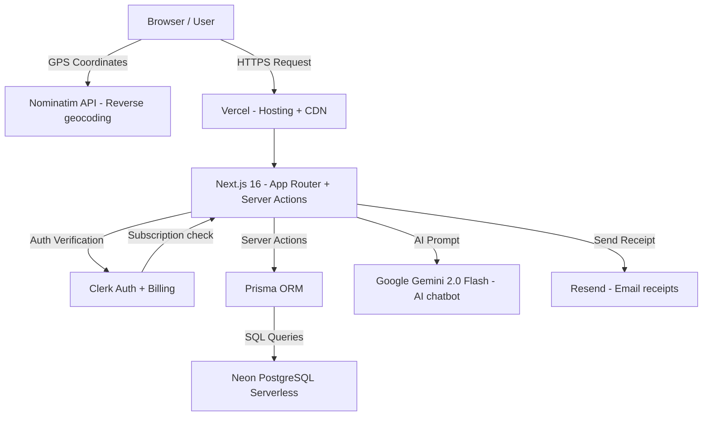
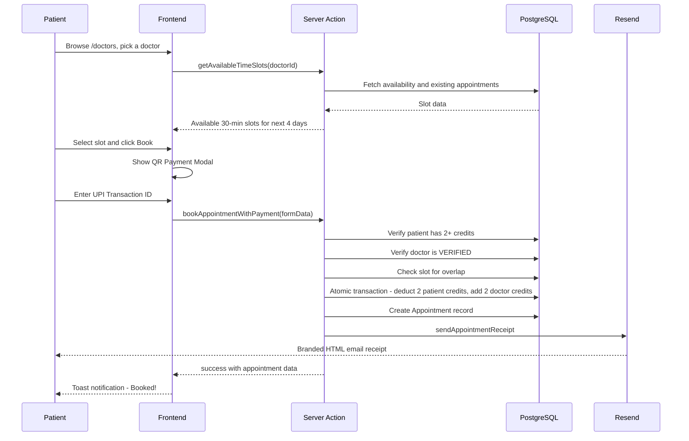
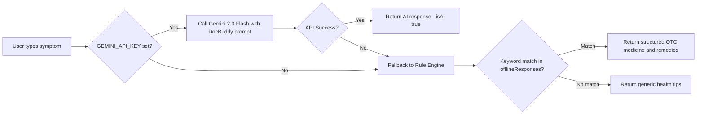
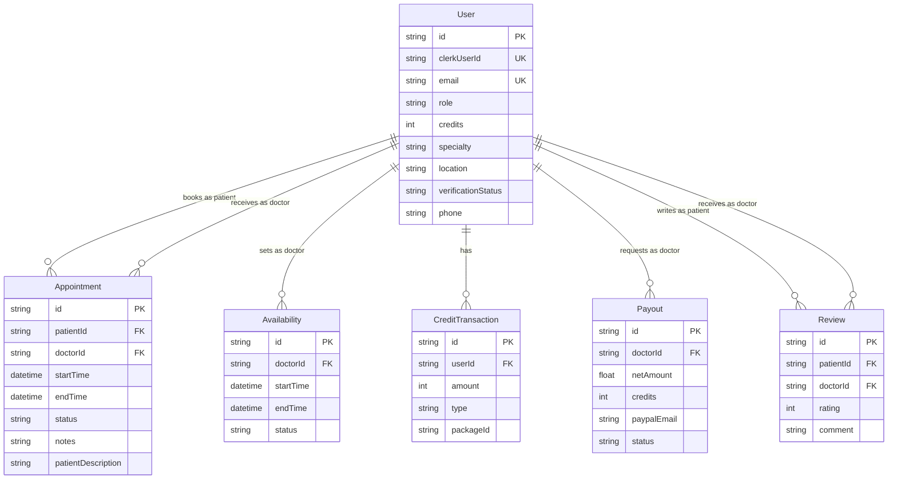

# DocFone — Complete Technical Project Analysis
**Project:** Doctor-Meet / DocFone  
**Developer:** Anuj Kumar | **Team Member:** Atharva Sharma  
**Course:** BCA — Project Code BCA-5005 | **College:** PSIT, Kanpur  
**GitHub:** https://github.com/anujkumar-18/Doctor-Meet  
**Live Website:** https://doctors-fone.vercel.app/  
**Analysis Date:** October 2026 | **Codebase:** Verified from `c:\docmeet`

---

## Table of Contents
1. [Complete Project Overview](#1-complete-project-overview)
2. [Technology Stack](#2-complete-technology-stack)
3. [Architecture Breakdown](#3-complete-architecture-breakdown)
4. [All Features and Modules](#4-all-existing-features-and-modules)
5. [New Features and Recent Modifications](#5-new-features-and-recent-modifications)
6. [Database Design](#6-database-design)
7. [Frontend Analysis](#7-frontend-analysis)
8. [Backend Analysis](#8-backend-analysis)
9. [Third-Party Integrations](#9-third-party-integrations)
10. [Challenges and Solutions](#10-challenges-and-solutions)
11. [Testing and Deployment](#11-testing-and-deployment)
12. [Security and Privacy](#12-security-and-privacy)
13. [Future Scope](#13-future-scope)

---

## 1. Complete Project Overview

### What is DocFone?
DocFone (repository name: Doctor-Meet) is a full-stack healthcare appointment booking platform developed as a BCA final-year project. It connects verified doctors with patients in a structured, credit-based model — allowing patients to discover doctors, book time-slotted appointments, interact with an AI health assistant, and manage their health records, all from a single web application.

### Problem Statement
Healthcare in India, particularly in tier-2 and tier-3 cities, suffers from:
- Difficulty finding the right specialist quickly
- Long wait times at physical clinics
- No centralised digital record of medical history
- Patients unable to identify relevant doctors based on symptoms or location
- Doctors lacking a digital presence and appointment management tool

### Target Users
| Role | Description |
|------|-------------|
| **Patient** | Books appointments, manages health details, uses DocBuddy AI assistant |
| **Doctor** | Registers, sets availability, manages appointments, requests payouts |
| **Admin** | Verifies doctors, adjusts credits, approves payout requests |

### Core Value Proposition
Unlike generic booking websites, DocFone includes:
- **Credit-based booking system** — patients purchase credit packages; each appointment costs 2 credits
- **AI Health Assistant (DocBuddy)** — Gemini 2.0 Flash-powered chatbot with offline fallback for common ailments, supporting English and Hinglish
- **Location-based doctor recommendation** — uses GPS and symptom filtering to suggest the most relevant local doctors after login
- **Doctor verification workflow** — Admin vets each doctor before they appear to patients
- **Earnings & payout system** — Doctors accumulate credits per appointment and can request PayPal payouts reviewed by admins
- **Email receipts** — Branded HTML receipts sent via Resend after payment booking
- **Patient medical profile** — Stores blood group, allergies, weight, height, age, and primary health concern

### Application Flow (End-to-End)
1. User visits `doctors-fone.vercel.app` → Landing page with features, pricing, and testimonials
2. User signs up via Clerk → Auto-synced to PostgreSQL via `checkUser.js`
3. User proceeds to Onboarding → Selects role (PATIENT / DOCTOR) and fills required fields
4. **Patient:** Browses doctors at `/doctors` → Books an appointment (credit deducted atomically) → Receives email receipt → Views appointments at `/appointments`
5. **Doctor:** Awaits admin verification → Sets availability → Manages patient appointments → Marks completed → Requests payout
6. **Admin:** Reviews pending doctors at `/admin` → Verifies/Rejects → Approves payout requests
7. **All users:** Interact with DocBuddy AI chatbot (floating widget) on any page

---

## 2. Complete Technology Stack

### Frontend
| Technology | Version | Purpose | Where Used |
|---|---|---|---|
| **Next.js** | ^16.0.0 | Full-stack React framework with App Router | `app/` directory, all pages |
| **React** | ^19.0.0 | UI component library | All `.jsx` / `.js` components |
| **TailwindCSS** | ^4.1.7 | Utility-first CSS framework | All components via `globals.css` |
| **tw-animate-css** | ^1.2.9 | Animation utilities for Tailwind | Chatbot, modal animations |
| **Lucide React** | ^0.510.0 | Icon library | Header, cards, dashboards |
| **next-themes** | ^0.4.6 | Dark/light mode theming | `theme-provider.jsx` |
| **Radix UI** | Various ^1.x | Headless accessible UI primitives | Dialog, Select, Tabs, Alert |
| **Sonner** | ^2.0.3 | Toast notifications | Booking confirmation, payout |
| **react-spinners** | ^0.17.0 | Loading spinners | Booking modals |

### Backend & Server-Side
| Technology | Version | Purpose | Where Used |
|---|---|---|---|
| **Next.js Server Actions** | ^16.0.0 | Type-safe server functions | `actions/` directory (11 files) |
| **Next.js App Router** | ^16.0.0 | Server Components & routing | `app/` directory |
| **Turbopack** | Built-in | Fast dev server bundler | `npm run dev --turbopack` |

### Database & ORM
| Technology | Version | Purpose | Where Used |
|---|---|---|---|
| **Prisma ORM** | ^6.8.2 / Client ^6.7.0 | Type-safe DB access | `lib/prisma.js`, all action files |
| **Neon PostgreSQL** | Serverless | Cloud-hosted relational database | `DATABASE_URL` env var |
| **Prisma Migrate** | Built-in | Schema migrations | `prisma/migrations/` |

### Authentication
| Technology | Version | Purpose | Where Used |
|---|---|---|---|
| **Clerk** | ^6.19.3 | Full authentication + subscription management | `middleware.js`, all protected routes |
| **@clerk/themes** | ^2.2.43 | Themed Clerk UI components | `app/layout.js` |
| **Clerk Billing** | Built-in | Credit subscription plans | `actions/credits.js` |

### AI Integration
| Technology | Version | Purpose | Where Used |
|---|---|---|---|
| **Google Gemini 2.0 Flash** | @google/generative-ai ^0.24.1 | AI health assistant responses | `actions/chatbot.js` |
| **Offline Rule Engine** | Custom | Fallback when API key missing | `actions/chatbot.js` |

### Email Service
| Technology | Version | Purpose | Where Used |
|---|---|---|---|
| **Resend** | ^6.17.2 | Transactional email service | `lib/email.js` |

### Forms & Validation
| Technology | Version | Purpose | Where Used |
|---|---|---|---|
| **react-hook-form** | ^7.56.3 | Form state management | Onboarding, booking forms |
| **@hookform/resolvers** | ^5.0.1 | Zod resolver for RHF | Validation integration |
| **Zod** | ^3.24.4 | Runtime schema validation | `lib/schema.js` |
| **date-fns** | ^4.1.0 | Date manipulation | Slot generation, formatting |

### Deployment & Hosting
| Technology | Purpose |
|---|---|
| **Vercel** | Frontend hosting + serverless functions |
| **Neon PostgreSQL** | Serverless database (cloud-hosted) |

### External APIs
| Service | Purpose |
|---|---|
| **Nominatim (OpenStreetMap)** | Free reverse geocoding for location detection |
| **Browser Geolocation API** | GPS coordinates in `location-doctor-modal.jsx` |
| **Vonage Video SDK** | Referenced in `next.config.mjs` — NOT YET IMPLEMENTED |

---

## 3. Complete Architecture Breakdown

### High-Level System Architecture



### Authentication and Role-Based Access Flow

```mermaid
flowchart TD
    A[User visits site] --> B{Is route protected?}
    B -->|No| C[Allow access]
    B -->|Yes| D{Clerk: Is signed in?}
    D -->|No| E[Redirect to /sign-in]
    D -->|Yes| F[checkUser runs]
    F --> G{User in DB?}
    G -->|No| H[Create user with 100 credits, UNASSIGNED role]
    G -->|Yes| I[Load user + monthly transactions]
    H --> J{Role check}
    I --> J
    J -->|UNASSIGNED| K[Redirect to /onboarding]
    J -->|PATIENT| L[Patient dashboard access]
    J -->|DOCTOR| M{Verification status?}
    J -->|ADMIN| N[Full admin access]
    M -->|PENDING or REJECTED| O[/doctor/verification page]
    M -->|VERIFIED| P[Doctor dashboard access]
```

### Patient Appointment Booking Workflow



### AI Assistant DocBuddy Workflow



### Database Relationships



---

## 4. All Existing Features and Modules

### 4.1 User Authentication & Registration — **Implemented**
- **Provider:** Clerk v6.19.3
- **Pages:** `/sign-in`, `/sign-up` (Clerk-hosted components)
- **Auto-sync:** `lib/checkUser.js` — On every authenticated request, syncs Clerk user with the PostgreSQL `User` table; creates new records with 100 free credits for new users
- **Role flow:** New users start as `UNASSIGNED` → must complete onboarding → assigned `PATIENT` or `DOCTOR`
- **Files:** `lib/checkUser.js`, `middleware.js`, `app/(auth)/`

### 4.2 Onboarding — **Implemented**
- **Route:** `/onboarding`
- **Patient path:** Selects age and primary health problem → role set to `PATIENT` → redirected to `/doctors`
- **Doctor path:** Provides specialty, experience, credential document URL, description, and city/location → role set to `DOCTOR`, `verificationStatus = PENDING` → redirected to `/doctor/verification`
- **Files:** `actions/onboarding.js`, `app/(main)/onboarding/`

### 4.3 Doctor Discovery — **Implemented**
- **Route:** `/doctors` and `/doctors/[specialty]/[doctorId]`
- **Features:** Browse all verified doctors, filter by specialty (16 specialties), view doctor profiles, ratings, experience, location
- **Backend:** `actions/doctors-listing.js` — fetches only `VERIFIED` doctors
- **Files:** `app/(main)/doctors/`

### 4.4 Location-Based Doctor Recommendation — **Implemented**
- **Trigger:** Auto-shows modal once per session after login
- **Step 1:** GPS location via Browser Geolocation API → reverse-geocoded to city name via free Nominatim API (or manual city input)
- **Step 2:** Select health problem from 8 bilingual (English/Hindi) categories
- **Algorithm:** 4-priority matching — local specialist → specialist → local doctor → any verified doctor (max 6 results)
- **Display:** Animated modal with match-type badges, doctor cards with avg rating, Book Appointment and Call buttons
- **Files:** `components/location-doctor-modal.jsx`, `actions/location-doctors.js`

### 4.5 Appointment Booking (Credit-based) — **Implemented**
- **Route:** `/doctors/[specialty]/[doctorId]` → booking modal
- **Slot generation:** `getAvailableTimeSlots()` — generates 30-minute slots for the next 4 days based on doctor availability, excluding past slots and already-booked times
- **Credit cost:** 2 credits per appointment (deducted from patient, added to doctor in atomic Prisma transaction)
- **Conflict check:** Three-way overlap detection prevents double-booking
- **Files:** `actions/appointments.js`

### 4.6 Payment Flow with Email Receipt — **Implemented**
- **Trigger:** Patient clicks "Book with Payment"
- **Flow:** QR Payment Modal shows UPI QR code → Patient pays Rs. 299 → Enters transaction ID → Server action `bookAppointmentWithPayment()` runs
- **Receipt:** Styled HTML email sent via Resend to patient's email — includes doctor name, specialty, date, time, amount, transaction ID, and booking ID
- **Fallback:** If email fails, booking still succeeds (non-blocking)
- **Files:** `components/appointment-payment-modal.jsx`, `components/qr-payment-modal.jsx`, `lib/email.js`, `actions/appointments.js`

### 4.7 Appointment Management — **Implemented**
- **Patient route:** `/appointments` — view scheduled and past appointments
- **Doctor route:** `/doctor` dashboard — view upcoming appointments with patient details
- **Actions available:**
  - Cancel appointment (by doctor or patient) — mutual cancellation with credit refund in transaction
  - Mark as completed (doctor only, enforced after `endTime`)
  - Add clinical notes to appointment (doctor only)
- **Status transitions:** `SCHEDULED → COMPLETED` or `SCHEDULED → CANCELLED`
- **Files:** `actions/doctor.js`, `components/appointment-card.jsx`

### 4.8 Doctor Profile Management — **Implemented**
- **Route:** `/doctor/update-profile`
- **Doctor dashboard:** `/doctor` — shows earnings summary, upcoming appointments, availability settings, payout history
- **Availability:** Doctor sets a single start-end time window (daily availability slot template repeated over next 4 days)
- **Files:** `app/(main)/doctor/`, `actions/doctor.js`

### 4.9 Admin Dashboard — **Implemented**
- **Route:** `/admin`
- **Protection:** All admin server actions call `verifyAdmin()` which checks `user.role === "ADMIN"` in DB
- **Features:**
  - View pending doctor verification requests (with credential URL)
  - Approve (VERIFIED) or Reject doctors
  - Suspend/reinstate a verified doctor (sets back to PENDING)
  - View and approve pending payout requests
  - Manually add credits to any user by email
- **Files:** `actions/admin.js`, `app/(main)/admin/`

### 4.10 Credits and Subscription System — **Implemented**
- **Plans (Clerk Billing):** `free_user` (0 extra credits), `standard` (10 credits/month), `premium` (24 credits/month)
- **New user credits:** 100 credits on registration (for testing/demo purposes, as seen in `checkUser.js`)
- **Monthly allocation:** `checkAndAllocateCredits()` runs on each page load via `CreditInitializer` client component — checks Clerk subscription plan and prevents duplicate monthly allocation
- **Credit display:** Header shows live credit balance for patients; "Earned Credits" for doctors
- **Transaction log:** Every credit change is recorded in `CreditTransaction` table with type and packageId
- **Files:** `actions/credits.js`, `components/credit-initializer.jsx`, `components/header.jsx`

### 4.11 Doctor Earnings and Payout System — **Implemented**
- **Earnings model:** Each appointment earns the doctor 2 credits → valued at $8/credit net ($10 gross, $2 platform fee)
- **Request payout:** Doctor submits PayPal email → `Payout` record created with `PROCESSING` status
- **Admin approval:** Admin verifies credit balance → marks `PROCESSED` → credits deducted from doctor's account atomically
- **Payout history:** Shown in doctor dashboard
- **Files:** `actions/payout.js`, `actions/admin.js`, `app/(main)/doctor/`

### 4.12 DocBuddy AI Assistant — **Implemented**
- **Floating widget:** Available on all pages (bottom-right), animated floating button with custom doctor mascot image
- **AI model:** Google Gemini 2.0 Flash via `@google/generative-ai`
- **Offline fallback:** Rule-based keyword engine with 6 categories (fever, cough, headache, stomach, skin, weakness) including English and Hinglish keyword matching
- **Personalization:** Fetches logged-in user profile (name, age, primaryProblem) and personalizes the welcome message
- **Safety:** Always adds medical disclaimer; never suggests prescription drugs
- **Markdown rendering:** Custom renderer for bold and bullet formatting
- **Files:** `actions/chatbot.js`, `components/chatbot-widget.jsx`

### 4.13 Patient Medical Details — **Implemented**
- **Route:** `/medical-details`
- **Stored fields:** Blood group, allergies, medical history, weight, height, age, primary problem
- **Purpose:** Improves doctor diagnosis during appointments
- **Files:** `app/(main)/medical-details/`, `actions/patient.js`

### 4.14 Doctor Ratings and Reviews — **Implemented (Backend) / Partially (UI)**
- **Backend:** `actions/reviews.js` — `submitReview()` and `getDoctorReviews()` fully implemented
- **Data model:** `Review` model with patientId, doctorId, rating (1–5), comment
- **Used in:** Location modal computes and shows average ratings; doctor listing shows ratings
- **Files:** `actions/reviews.js`, `prisma/schema.prisma`

### 4.15 Responsive Design and Mobile Support — **Implemented**
- **Approach:** Tailwind CSS responsive utilities (`hidden lg:flex`, `md:inline-flex`)
- **Header:** Icon-only buttons on mobile, full text labels on desktop
- **Location Modal:** `max-height: 90vh` with internal scroll for small screens
- **Files:** All component files

---

## 5. New Features and Recent Modifications

> Note: Git history was not directly accessible during this analysis. Changes are identified from code examination and conversation history context.

| Feature or Change | Previous Behavior | New Behavior | Files Modified | Status |
|---|---|---|---|---|
| Location-Based Doctor Recommendation | No location feature | Auto-modal on login with GPS plus symptom matching | `location-doctor-modal.jsx`, `location-doctors.js` | Implemented |
| DocBuddy AI Chatbot | No chatbot | Floating Gemini-powered assistant with offline fallback | `chatbot.js`, `chatbot-widget.jsx` | Implemented |
| UPI QR Payment + Email Receipt | Credit-only booking | QR modal with transaction ID plus Resend email receipt | `qr-payment-modal.jsx`, `appointment-payment-modal.jsx`, `lib/email.js` | Implemented |
| Doctor Reviews and Ratings | No reviews | Review model plus submitReview action plus avg rating in location modal | `actions/reviews.js`, schema | Implemented |
| Payout System | No payout | Doctor credit-to-cash payout via PayPal with admin approval | `payout.js`, `admin.js`, schema | Implemented |
| Medical Details Page | No health profile | Patient stores blood group, allergies, weight, height etc. | `medical-details/`, `patient.js` | Implemented |
| Header Optimization | Credit check in header | Credit check moved to CreditInitializer client component (non-blocking) | `header.jsx`, `credit-initializer.jsx` | Implemented |
| Bilingual UI (Hinglish) | English only | Location modal and DocBuddy support Hindi/Hinglish | `location-doctor-modal.jsx`, `chatbot.js` | Implemented |
| Doctor location field | No location | Doctors set city on onboarding; indexed for fast filtering | schema, `onboarding.js` | Implemented |
| Doctor phone field | No phone number | Phone number stored and shown in location modal with Call button | schema, location modal | Implemented |
| Video Consultation Section | Mentioned on landing page | Section removed; schema retains videoSessionId field for future use | `app/page.js` | Removed from UI |

---

## 6. Database Design

### Database: Neon PostgreSQL (Serverless) via Prisma ORM
**Schema file:** `prisma/schema.prisma`

### User Model (Unified for all roles)
| Field | Type | Purpose |
|---|---|---|
| `id` | String UUID | Primary key |
| `clerkUserId` | String unique | Link to Clerk authentication |
| `email` | String unique | User email |
| `name` | String optional | Full name |
| `role` | UserRole | UNASSIGNED / PATIENT / DOCTOR / ADMIN |
| `credits` | Int default 2 | Credit balance (new users get 100) |
| `bloodGroup` | String optional | Patient field |
| `allergies` | Text optional | Patient field |
| `medicalHistory` | Text optional | Patient field |
| `weight` | Float optional | Patient field |
| `height` | Float optional | Patient field |
| `age` | Int optional | Patient field |
| `primaryProblem` | Text optional | Patient field shown to DocBuddy |
| `specialty` | String optional | Doctor field |
| `experience` | Int optional | Doctor field - years |
| `credentialUrl` | String optional | Doctor field - document link |
| `description` | Text optional | Doctor bio |
| `location` | String optional | Doctor city or area |
| `verificationStatus` | VerificationStatus | PENDING / VERIFIED / REJECTED |
| `phone` | String optional | Doctor contact number |

**Indexes:** `(role, verificationStatus)`, `(location)`, `(specialty)`

### Appointment Model
| Field | Type | Purpose |
|---|---|---|
| `id` | String UUID | Primary key |
| `patientId` | String FK to User | Patient reference |
| `doctorId` | String FK to User | Doctor reference |
| `startTime` | DateTime | Appointment start |
| `endTime` | DateTime | Appointment end |
| `status` | AppointmentStatus | SCHEDULED / COMPLETED / CANCELLED |
| `notes` | Text optional | Doctor clinical notes |
| `patientDescription` | Text optional | Patient issue description |
| `videoSessionId` | String optional | Vonage session ID - reserved for future |
| `videoSessionToken` | String optional | Vonage token - reserved for future |

### Availability Model
| Field | Type | Purpose |
|---|---|---|
| `id` | String UUID | Primary key |
| `doctorId` | String FK to User | Doctor reference (cascade delete) |
| `startTime` | DateTime | Window start time |
| `endTime` | DateTime | Window end time |
| `status` | SlotStatus | AVAILABLE / BOOKED / BLOCKED |

### CreditTransaction Model
| Field | Type | Purpose |
|---|---|---|
| `id` | String UUID | Primary key |
| `userId` | String FK to User | User reference (cascade delete) |
| `amount` | Int | Positive for credit, negative for debit |
| `type` | TransactionType | CREDIT_PURCHASE / APPOINTMENT_DEDUCTION / ADMIN_ADJUSTMENT |
| `packageId` | String optional | Plan reference: free_user, standard, premium, manual_add |

### Payout Model
| Field | Type | Purpose |
|---|---|---|
| `id` | String UUID | Primary key |
| `doctorId` | String FK to User | Doctor reference (cascade delete) |
| `amount` | Float | Total payout (credits x $10) |
| `credits` | Int | Credits being cashed out |
| `platformFee` | Float | $2 per credit |
| `netAmount` | Float | $8 per credit to doctor |
| `paypalEmail` | String | Destination PayPal email |
| `status` | PayoutStatus | PROCESSING / PROCESSED |
| `processedAt` | DateTime optional | When admin processed it |
| `processedBy` | String optional | Admin internal ID |

### Review Model
| Field | Type | Purpose |
|---|---|---|
| `id` | String UUID | Primary key |
| `patientId` | String FK to User | Who reviewed |
| `doctorId` | String FK to User | Who was reviewed |
| `rating` | Int | 1 to 5 stars |
| `comment` | Text optional | Optional feedback |

### Database Operations Notes
- **Transactions:** Used in credit deduction, cancellation refund, and payout processing using `db.$transaction()` for ACID consistency
- **Cascade deletes:** `Availability`, `CreditTransaction`, `Payout` cascade when User is deleted
- **Atomic credit management:** All credit changes (patient decrement + doctor increment) happen in a single Prisma transaction to prevent partial updates

---

## 7. Frontend Analysis

### Pages and Routes

| Route | Purpose | Auth Required |
|---|---|---|
| `/` | Landing page — hero, features, pricing, testimonials, CTA | No |
| `/sign-in` | Clerk sign-in | No |
| `/sign-up` | Clerk sign-up | No |
| `/onboarding` | Role selection and profile completion | Yes |
| `/doctors` | Browse verified doctors, filter by specialty | No |
| `/doctors/[specialty]/[doctorId]` | Doctor profile + booking modal | No (booking requires auth) |
| `/appointments` | Patient's appointment list | Yes - PATIENT |
| `/medical-details` | Patient health profile | Yes - PATIENT |
| `/doctor` | Doctor dashboard | Yes - DOCTOR |
| `/doctor/update-profile` | Edit doctor profile | Yes - DOCTOR |
| `/doctor/verification` | Pending verification status page | Yes - DOCTOR |
| `/admin` | Admin dashboard | Yes - ADMIN |
| `/pricing` | Pricing and subscription page | No |

### Shared Components

| Component | File | Purpose |
|---|---|---|
| Header | `components/header.jsx` | Navigation, role-aware buttons, credit display |
| ChatbotWidget | `components/chatbot-widget.jsx` | Floating DocBuddy AI assistant |
| LocationDoctorModal | `components/location-doctor-modal.jsx` | Post-login doctor recommendation modal |
| AppointmentCard | `components/appointment-card.jsx` | Appointment display for patient and doctor |
| AppointmentPaymentModal | `components/appointment-payment-modal.jsx` | Booking modal with slot selection |
| QRPaymentModal | `components/qr-payment-modal.jsx` | UPI QR payment modal |
| CreditInitializer | `components/credit-initializer.jsx` | Client component that triggers monthly credit allocation |
| Pricing | `components/pricing.jsx` | Clerk pricing table wrapper |
| PricingCard | `components/pricing-card.jsx` | Individual plan card |
| PageHeader | `components/page-header.jsx` | Reusable page title and subtitle header |
| ThemeProvider | `components/theme-provider.jsx` | next-themes dark mode provider |

### State Management
- **Server Components** (default in App Router) — no client-side state; data fetched server-side
- **Client Components** — `"use client"` directive used in: `chatbot-widget.jsx`, `location-doctor-modal.jsx`, `appointment-payment-modal.jsx`, `qr-payment-modal.jsx`, `credit-initializer.jsx`
- **Form state:** react-hook-form + Zod validation in onboarding and profile forms
- **Toast notifications:** Sonner for success/error feedback

### Design System
- **Color scheme:** Dark background, emerald green accents
- **Glassmorphism:** `backdrop-blur-md` on header
- **Animations:** Custom `docbuddy-float` keyframe animation on chatbot button, `animate-pulse` for online indicator

---

## 8. Backend Analysis

### Server Actions Architecture
All business logic is in `actions/` as Next.js Server Actions with the `"use server"` directive. Each action:
1. Verifies auth via `auth()` from Clerk
2. Looks up the user in the database by `clerkUserId`
3. Checks role-specific permissions
4. Executes business logic (often in `db.$transaction()`)
5. Calls `revalidatePath()` to invalidate cached pages
6. Returns `{ success: true/false, data/error }`

### Key Server Actions

| Action | File | Accepts | Does | Returns |
|---|---|---|---|---|
| `bookAppointment` | `appointments.js` | FormData with doctorId, startTime, endTime, description | Checks credits, slot overlap, deducts credits atomically, creates appointment | success and appointment |
| `bookAppointmentWithPayment` | `appointments.js` | FormData plus transactionId and amountPaid | Same as above plus sends email receipt | success and appointment |
| `getAvailableTimeSlots` | `appointments.js` | doctorId | Fetches availability window, generates 30-min slots for next 4 days, excludes booked slots | days array with slots |
| `cancelAppointment` | `doctor.js` | FormData with appointmentId | Verifies ownership, cancels in transaction, refunds patient credits | success |
| `markAppointmentCompleted` | `doctor.js` | FormData with appointmentId | Verifies doctor, checks now is after endTime, sets COMPLETED | success and appointment |
| `addAppointmentNotes` | `doctor.js` | FormData with appointmentId and notes | Verifies doctor owns appointment, updates notes | success and appointment |
| `setAvailabilitySlots` | `doctor.js` | FormData with startTime and endTime | Deletes old slots, creates new availability window | success and slot |
| `setUserRole` | `onboarding.js` | FormData with role and role-specific fields | Updates user role and related fields | success and redirect path |
| `getPendingDoctors` | `admin.js` | none | Lists doctors with PENDING verification | doctors array |
| `updateDoctorStatus` | `admin.js` | FormData with doctorId and status | Sets VERIFIED or REJECTED | success |
| `approvePayout` | `admin.js` | FormData with payoutId | Validates credits, marks PROCESSED, deducts from doctor atomically | success |
| `addManualCredits` | `admin.js` | FormData with email and credits | Finds user by email, increments credits, logs transaction | success |
| `checkAndAllocateCredits` | `credits.js` | user object | Checks Clerk subscription plan, allocates monthly credits if not already done | Updated user |
| `deductCreditsForAppointment` | `credits.js` | userId, doctorId | Atomic: -2 patient, +2 doctor, logs both transactions | success |
| `requestPayout` | `payout.js` | FormData with paypalEmail | Checks no pending payout exists, calculates amounts, creates Payout record | success and payout |
| `getSuggestedDoctors` | `location-doctors.js` | city string, problem string | 4-tier priority doctor search with avg rating computation | doctors array and specialties |
| `askSmartChatbot` | `chatbot.js` | userInput string | Calls Gemini 2.0 Flash or offline rule engine | reply text and isAI boolean |
| `submitReview` | `reviews.js` | FormData with doctorId, rating, comment | Creates Review record for patient only | success and review |

### Appointment Slot Generation Logic
The `getAvailableTimeSlots` function:
1. Fetches doctor's single availability record (start/end time window)
2. Iterates over next 4 days
3. For each day, copies the availability window's hours to that date
4. Generates 30-minute slots from `availabilityStart` to `availabilityEnd`
5. Skips past time slots
6. Skips slots that overlap with any existing SCHEDULED appointment (three-way overlap check)
7. Returns grouped array of days with their available slots

### Credit Economy
- Patients spend 2 credits per appointment
- Doctors earn 2 credits per appointment
- Standard plan: 10 credits/month via Clerk Billing
- Premium plan: 24 credits/month via Clerk Billing
- Doctor cash value: $8 per credit net ($2 platform fee)
- All credit transfers use `db.$transaction()` for consistency

---

## 9. Third-Party Integrations

### 9.1 Clerk (Authentication + Billing)
- **Purpose:** Complete authentication system plus subscription plan management
- **Config:** `CLERK_PUBLISHABLE_KEY`, `CLERK_SECRET_KEY` env vars
- **Usage:** Middleware route protection, user sync, subscription tier check, UI components
- **Plans configured:** `free_user`, `standard` (10 credits), `premium` (24 credits)
- **Status:** Fully integrated and working

### 9.2 Neon PostgreSQL + Prisma
- **Purpose:** Primary data storage
- **Config:** `DATABASE_URL` env var (Neon serverless URL)
- **Seed scripts:** `prisma/seed.js` and `prisma/seed-up-doctors.js` (Uttar Pradesh doctors seeder)
- **Status:** Fully integrated and working

### 9.3 Google Gemini AI
- **Purpose:** Powers DocBuddy AI health assistant
- **Config:** `GEMINI_API_KEY` env var
- **Model used:** `gemini-2.0-flash`
- **Prompt engineering:** DocBuddy role, language detection, OTC-only advice, mandatory medical disclaimer
- **Status:** Working when API key is configured; offline rule engine serves as fallback

### 9.4 Resend (Email)
- **Purpose:** Transactional email receipts after payment booking
- **Config:** `RESEND_API_KEY` env var
- **From address:** `Docfone <onboarding@resend.dev>`
- **Template:** Custom dark-themed HTML email with emerald accents, appointment details, payment receipt
- **Lazy init:** Client created with fallback dummy key to prevent build failures on Vercel
- **Status:** Working when API key is configured; booking proceeds even if email fails

### 9.5 Nominatim (OpenStreetMap) Reverse Geocoding
- **Purpose:** Convert GPS coordinates to city name for free
- **Usage:** Client-side in `location-doctor-modal.jsx` with user's lat/lng
- **Status:** Working (free service, no API key needed)
- **Limitation:** Accuracy depends on GPS precision and Nominatim updates

### 9.6 Vonage Video SDK
- **Purpose:** Video consultation (planned but NOT implemented)
- **Evidence:** `next.config.mjs` lists `@vonage/server-sdk`, `@vonage/auth`, `@vonage/video` in `serverExternalPackages`; `Appointment` model has `videoSessionId` and `videoSessionToken` fields
- **Status:** NOT IMPLEMENTED — schema and config prepared, but no actual Vonage calls exist in the codebase

### 9.7 Vercel
- **Purpose:** Hosting, CDN, serverless function execution
- **Status:** Live at `https://doctors-fone.vercel.app/`

---

## 10. Challenges and Solutions

### Challenge 1: Credit Consistency During Concurrent Bookings
- **Problem:** If two patients try to book the same slot simultaneously, credits could be double-deducted or slots oversold
- **Solution:** All credit operations and appointment creation are wrapped in `db.$transaction()`. The overlap check and credit deduction happen atomically
- **Files:** `actions/credits.js`, `actions/appointments.js`

### Challenge 2: Build Failures on Vercel Due to Missing ENV Keys
- **Problem:** Resend client initialization at module load time crashes Vercel builds when `RESEND_API_KEY` is not set
- **Solution:** Lazy initialization pattern — `getResendClient()` function creates the client only when first called at runtime, with a safe fallback string
- **Files:** `lib/email.js`

### Challenge 3: Gemini API Rate Limits and Unavailability
- **Problem:** Gemini API calls may fail due to rate limits, network issues, or missing API key in staging environments
- **Solution:** Two-tier fallback system — Gemini is tried first; on any error, the offline rule-based engine with keyword matching handles the response, ensuring DocBuddy always responds
- **Files:** `actions/chatbot.js`

### Challenge 4: Performance — Credit Check Blocking Header Render
- **Problem:** Calling Clerk subscription check in the server-rendered Header was blocking page render under high load
- **Solution:** Credit allocation logic moved to a separate `CreditInitializer` client component that runs independently
- **Files:** `components/credit-initializer.jsx`, `components/header.jsx`

### Challenge 5: Location Feature Without GPS
- **Problem:** Users who deny location permission cannot use GPS-based doctor filtering
- **Solution:** Fallback manual city input field alongside the GPS button; location step can also be skipped entirely
- **Files:** `components/location-doctor-modal.jsx`

### Challenge 6: Slot Double-Booking Prevention
- **Problem:** Multiple patients could book the same 30-minute slot if requests arrive simultaneously
- **Solution:** Three-way overlap check using Prisma query with OR conditions covering all partial-overlap scenarios
- **Files:** `actions/appointments.js`

### Challenge 7: Mobile Responsive Layout Issues
- **Problem:** Doctor information cards and UI components were getting cut off on small screens
- **Solution:** Added responsive Tailwind classes, `min-w-0` with `truncate` on text elements, `flex-wrap` on metadata rows
- **Files:** `components/location-doctor-modal.jsx`

---

## 11. Testing and Deployment

### Build and Deployment
- **Framework:** Next.js 16 with Turbopack dev server
- **Build command:** `npm run build` → `next build`
- **Dev server:** `npm run dev` → `next dev --turbopack`
- **Post-install:** `prisma generate` (auto-runs after `npm install`)
- **Hosting:** Vercel (automatic GitHub CI/CD)

### Environment Variables (Names Only — No Values)
| Variable | Purpose |
|---|---|
| `DATABASE_URL` | Neon PostgreSQL connection string |
| `NEXT_PUBLIC_CLERK_PUBLISHABLE_KEY` | Clerk frontend key |
| `CLERK_SECRET_KEY` | Clerk backend key |
| `NEXT_PUBLIC_CLERK_SIGN_IN_URL` | Clerk sign-in route |
| `NEXT_PUBLIC_CLERK_SIGN_UP_URL` | Clerk sign-up route |
| `GEMINI_API_KEY` | Google Gemini AI key |
| `RESEND_API_KEY` | Resend email service key |

### Automated Tests
- **Status:** No automated test suite found in the codebase
- **Recommendation:** Add Jest + React Testing Library for component tests; Playwright for E2E tests

### Manual Testing Scenarios (Verified Working)
1. Sign up → onboarding as PATIENT → browse doctors → book appointment → view at /appointments
2. Sign up → onboarding as DOCTOR → admin approves → set availability → appointment shows in doctor dashboard
3. Admin: verify doctor, add manual credits, approve payout
4. DocBuddy: type "I have fever" → get AI or offline response with disclaimer
5. Location modal: allow GPS → select city → pick problem → see matched doctors
6. Payment flow: QR modal → enter transaction ID → booking + email receipt

### Known Limitations
- Video consultation (Vonage) is not implemented despite schema fields being present
- Email receipt template mentions "join video call" but no actual video feature exists
- No automated test coverage

---

## 12. Security and Privacy

### Authentication Security
- All protected routes guarded by Clerk middleware in `middleware.js`
- Every server action independently verifies `userId` via Clerk's `auth()`
- Admin actions call `verifyAdmin()` which queries the database directly

### Authorization Checks
- `cancelAppointment` verifies the user is either the patient or doctor for that specific appointment
- `markAppointmentCompleted` and `addAppointmentNotes` verify the doctor owns that appointment
- Payout requests verified that doctor has sufficient credits before processing

### Data Protection
- No API keys or credentials stored in the codebase
- `.env` file is in `.gitignore`
- Prisma parameterized queries prevent SQL injection
- Patient medical details stored in DB but not exposed to unauthorized roles

### Security Concerns and Recommendations

| Concern | Severity | Recommendation |
|---|---|---|
| No rate limiting on server actions | Medium | Add rate limiting to booking and chatbot endpoints |
| Admin role assigned manually in DB only | Low | Document the process clearly |
| Vonage fields in schema but feature not implemented | Low | Add comments marking them as reserved |
| Email receipt mentions video call — feature not available | Medium | Update email template to remove video call instruction |
| `checkUser.js` gives 100 credits to new users | Low | Reduce to 2 for production; 100 is suitable for development |
| Patient medical data not encrypted at rest | Medium | Consider field-level encryption for sensitive health data |

---

## 13. Future Scope

> The following features are NOT yet implemented. They are proposed enhancements for future development.

### High Priority
1. **Video Consultation (Vonage):** Schema and config already prepared. Implement Vonage Video API session creation and in-browser video call UI
2. **Automated Testing Suite:** Add Jest + Playwright for regression testing before each deployment
3. **Appointment Reminders:** Send email reminders 24 hours and 1 hour before appointments using Resend plus Vercel Cron

### Medium Priority
4. **Production Payment Gateway:** Replace the manual UPI QR flow with Razorpay or Stripe for automated payment verification
5. **Doctor Reviews on Doctor Profile Page:** Backend exists; complete the frontend UI to display and submit reviews
6. **Advanced Analytics Dashboard:** Show doctors monthly appointment trends, peak days, specialty-wise bookings
7. **Push Notifications / PWA:** Service worker plus Web Push for appointment reminders on mobile

### Long-Term
8. **Mobile Application (React Native):** Cross-platform app for iOS and Android
9. **Multilingual Support (i18n):** Full Hindi language support across the platform
10. **Medical Records Management:** Let patients upload and share diagnostic reports with doctors
11. **Doctor Rating-Based Search Ranking:** Rank doctors by average rating in the main /doctors listing
12. **Scalability Improvements:** Add Redis caching for slot generation, database connection pooling via PgBouncer
13. **Accessibility (WCAG 2.1):** Screen reader support, keyboard navigation for all modals and forms
14. **Admin Analytics:** System-wide stats — total users, revenue, appointments, active doctors
