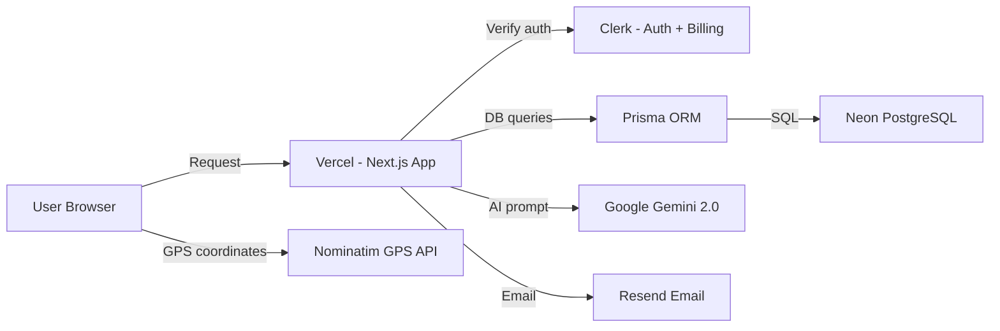
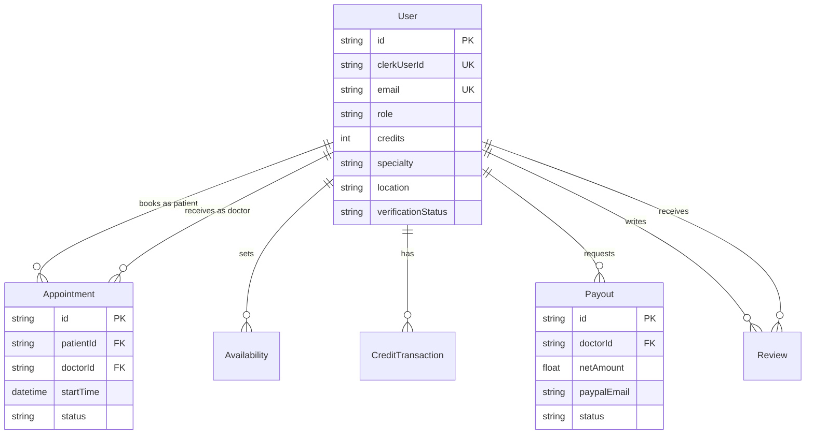
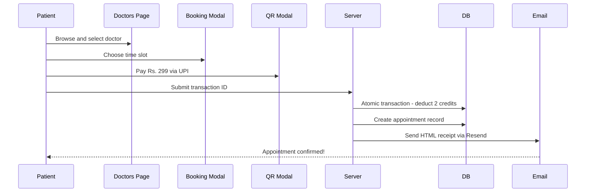
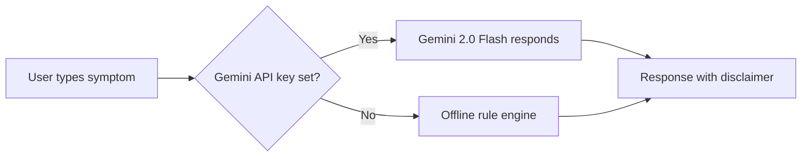
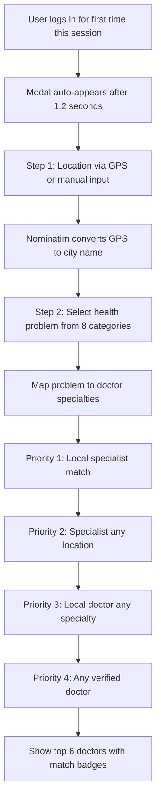

# DocFone — Presentation Outline & Viva Questions
**Project:** Doctor-Meet / DocFone  
**Developer:** Anuj Kumar | **Team Member:** Atharva Sharma  
**Course:** BCA — Project Code BCA-5005 | **College:** PSIT, Kanpur  
**Live Website:** https://doctors-fone.vercel.app/

---

## Screenshot Checklist

Before your presentation, capture screenshots of these specific pages/states:

| # | What to Capture | URL / Route |
|---|---|---|
| 1 | Landing page (hero section with banner image) | `/` |
| 2 | Pricing section (credit packages) | `/#pricing` |
| 3 | Doctor listing page with specialty filter | `/doctors` |
| 4 | Individual doctor profile with booking modal | `/doctors/[specialty]/[doctorId]` |
| 5 | Appointment booking time slot selection | Booking modal on doctor page |
| 6 | QR payment modal with UPI code | Triggered in booking flow |
| 7 | Email receipt (screenshot from inbox or HTML) | Resend email in patient inbox |
| 8 | Patient appointments page | `/appointments` |
| 9 | Patient medical details page | `/medical-details` |
| 10 | Doctor dashboard with earnings and appointments | `/doctor` |
| 11 | Admin dashboard — pending doctors and payouts | `/admin` |
| 12 | Location recommendation modal (after login) | Auto-shows after login |
| 13 | DocBuddy chatbot open with a response | Bottom-right floating widget |
| 14 | Onboarding role selection page | `/onboarding` |
| 15 | Doctor verification pending page | `/doctor/verification` |

---

## Part A — Slide-by-Slide Presentation Outline (16 Slides)

---

### Slide 1 — Title Slide

**Purpose:** Professional introduction to the project and team.

**Bullet Points:**
- Project Name: DocFone (Doctor-Meet)
- Full-Stack Healthcare Appointment Booking Platform
- Developer: Anuj Kumar | Team: Atharva Sharma
- Course: BCA — Code BCA-5005 | College: PSIT, Kanpur
- Live: doctors-fone.vercel.app | GitHub: anujkumar-18/Doctor-Meet

**Suggested Visual:** DocFone logo with a dark emerald-themed background (screenshot of the landing page hero)

**Speaker Notes:**
> Good morning / afternoon [Panel]. My name is Anuj Kumar and this is my BCA final-year project, DocFone — a healthcare appointment booking platform. My team member is Atharva Sharma. This is a live, deployed application accessible at doctors-fone.vercel.app. Today I will walk you through the complete project — from the problem it solves to the technology behind it, and the features we have built.

---

### Slide 2 — Problem Statement

**Purpose:** Establish the real-world need that motivated the project.

**Bullet Points:**
- Patients in tier-2 cities struggle to find the right specialist quickly
- Long queues and wait times at physical clinics
- No single platform to store patient medical history digitally
- Doctors lack digital tools for appointment management
- No mechanism to recommend doctors based on patient symptoms and location

**Suggested Visual:** A simple illustration or diagram showing a patient waiting at a clinic vs. booking online instantly

**Speaker Notes:**
> Healthcare access in cities like Kanpur, Lucknow, and similar tier-2 cities is often inefficient. Patients don't know which specialist to visit for their problem, they waste time in queues, and there is no digital record of their health. On the doctor side, there is no easy tool to manage appointments. Our project, DocFone, solves all of these problems in one platform.

---

### Slide 3 — Objectives and Proposed Solution

**Purpose:** Define what the project set out to achieve.

**Bullet Points:**
- Build a verified doctor discovery and booking platform
- Implement a credit-based appointment payment system
- Provide AI-powered health advisory through DocBuddy chatbot
- Enable location-based doctor recommendations after login
- Create role-based dashboards for Patient, Doctor, and Admin

**Suggested Visual:** A three-column diagram showing Patient, Doctor, Admin with their key actions

**Speaker Notes:**
> Our objectives were to solve the problems I just described. We built a platform with four user roles — Unassigned (new user), Patient, Doctor, and Admin. Each role has a specific set of features. We also added an AI assistant powered by Google Gemini and a location-based recommendation system that suggests doctors near the patient's city.

---

### Slide 4 — User Roles and Access Levels

**Purpose:** Explain the role-based architecture clearly.

**Bullet Points:**
- **Unassigned:** New user, must complete onboarding to choose role
- **Patient:** Browse doctors → Book appointments → Manage medical profile → Use DocBuddy
- **Doctor:** Set availability → Manage appointments → Request payout from earned credits
- **Admin:** Verify doctors → Approve payouts → Manually manage credits

**Suggested Visual:** A role hierarchy diagram or a simple table showing role → permissions → key pages

**Speaker Notes:**
> The application has a clear role-based structure. When a user signs up, they are called Unassigned. On the onboarding page they choose whether they are a patient or a doctor. Admins are assigned directly in the database. Each role sees a different navigation, dashboard, and set of features. A patient cannot access the admin panel, and a doctor cannot book appointments for other doctors.

---

### Slide 5 — Technology Stack

**Purpose:** Show the technical depth of the project.

**Bullet Points:**
- **Frontend:** Next.js 16 (App Router), React 19, TailwindCSS 4, Lucide Icons
- **Backend:** Next.js Server Actions (no separate REST API needed)
- **Database:** Neon PostgreSQL (Serverless) + Prisma ORM 6.8
- **Authentication:** Clerk v6 (sign-in, sign-up, subscription billing)
- **AI:** Google Gemini 2.0 Flash via @google/generative-ai
- **Email:** Resend (transactional HTML receipts)
- **Hosting:** Vercel (live deployment with CI/CD from GitHub)

**Suggested Visual:** A technology stack diagram organized in three rows — Frontend, Backend/DB, Services

**Speaker Notes:**
> We used Next.js 16 with the App Router for both frontend and backend. Instead of building a separate REST API, we used Next.js Server Actions — functions that run on the server and are called directly from the client. This simplifies the codebase significantly. Our database is Neon PostgreSQL, a serverless cloud database, accessed through Prisma ORM. Authentication is handled entirely by Clerk. AI responses come from Google Gemini 2.0 Flash, and emails are sent using Resend.

---

### Slide 6 — System Architecture

**Purpose:** Visualize how all the components work together.

**Mermaid Diagram:**



**Bullet Points:**
- User requests go to Vercel (Next.js server)
- Clerk verifies authentication on every protected route
- Server Actions interact with Neon PostgreSQL through Prisma ORM
- Gemini AI provides DocBuddy responses; Resend sends email receipts
- Nominatim API (free, OpenStreetMap) converts GPS to city name

**Speaker Notes:**
> This diagram shows the complete architecture. The user's browser communicates with our Next.js application hosted on Vercel. Authentication is verified by Clerk. Data is stored in Neon PostgreSQL and accessed through Prisma. The AI chatbot calls the Gemini API, and after a payment booking, an email receipt is sent via Resend. For location-based recommendations, the browser's GPS is converted to a city name using the free Nominatim API.

---

### Slide 7 — Database Design (ER Diagram)

**Purpose:** Demonstrate backend data modeling skills.

**Mermaid ER Diagram:**



**Bullet Points:**
- 6 models: User, Appointment, Availability, CreditTransaction, Payout, Review
- Single `User` model handles all roles (patient, doctor, admin) with role-specific fields
- All relationships use UUID primary keys and foreign key constraints
- Cascade deletes on Availability, CreditTransaction, Payout when user is deleted
- Indexes on `(role, verificationStatus)`, `location`, and `specialty` for fast queries

**Speaker Notes:**
> Our database has six tables. The most important is the User table, which stores both patients and doctors — we use a role-based design rather than separate tables. Patient-specific fields like bloodGroup and allergies are null for doctors, and doctor-specific fields like specialty and credentialUrl are null for patients. The Appointment table connects a patient and a doctor with a time slot. The CreditTransaction table logs every credit movement for audit purposes.

---

### Slide 8 — Core Feature: Appointment Booking Flow

**Purpose:** Walk through the most important user workflow.

**Booking Workflow:**



**Bullet Points:**
- Doctor's availability set as a time window → auto-generates 30-minute slots for next 4 days
- Three-way overlap check prevents double booking at SCHEDULED status
- 2 credits deducted from patient atomically; 2 credits added to doctor in same transaction
- After payment: branded HTML email with doctor details, date/time, transaction ID, booking ID
- If Resend email fails, booking still succeeds (non-blocking error handling)

**Speaker Notes:**
> This is the core workflow of our application. The doctor sets their availability as a start and end time. When a patient views the doctor's profile, the system dynamically generates 30-minute slots for the next 4 days, skipping booked slots and past times. The patient selects a slot, pays using UPI via a QR code, enters their transaction ID, and clicks book. The server then deducts 2 credits from the patient and adds 2 credits to the doctor — all in a single atomic database transaction. Finally, a styled email receipt is sent to the patient's email via Resend.

---

### Slide 9 — Feature: DocBuddy AI Health Assistant

**Purpose:** Highlight the AI integration as a key differentiator.

**DocBuddy Workflow:**



**Bullet Points:**
- Floating animated widget on all pages, always accessible
- Primary: Google Gemini 2.0 Flash with DocBuddy system prompt
- Fallback: Custom keyword-matching engine with 6 health categories
- Supports English and Hinglish (Hindi-English mix) — detects language automatically
- Personalizes greeting using logged-in patient's name, age, and primary problem
- Always includes medical disclaimer — never suggests prescription drugs

**Speaker Notes:**
> DocBuddy is our AI health assistant. It appears as a floating animated button on every page. When a user types a symptom in English or Hindi, it calls the Google Gemini 2.0 Flash model with a carefully designed system prompt. If the Gemini API is unavailable, it falls back to our own offline rule-based engine that handles six common medical categories such as fever, cough, and headache. It always tells the user to consult a real doctor. For logged-in patients, it reads their profile and personalizes the welcome message using their name and primary health problem.

---

### Slide 10 — Feature: Location-Based Doctor Recommendation

**Purpose:** Showcase the intelligent, personalized onboarding experience.

**Location Recommendation Flow:**



**Bullet Points:**
- Automatically appears once per browser session after login (stored in sessionStorage)
- Step 1: GPS via Browser Geolocation → reverse-geocoded to city name via Nominatim (free API)
- Step 2: Select from 8 bilingual symptom categories (English and Hindi)
- 4-priority algorithm fills up to 6 most relevant doctor results
- Shows matchType badges: "Near You - Best Match", "Specialist Match", "Near You", "Top Doctor"
- Each result card shows name, specialty, location, experience, average rating, and phone Call button

**Speaker Notes:**
> When a user logs in for the first time in their browser session, a recommendation modal appears after 1.2 seconds. It asks for their location either via GPS or manual city input. Then it asks them to select their main health problem from 8 categories. Our server action maps the problem to relevant specialties and then runs a 4-priority search in the database — first looking for local specialists, then specialists anywhere, then local doctors, then any verified doctor — until we have 6 results. The results show match badges so the user knows why each doctor was suggested.

---

### Slide 11 — Feature: Admin Dashboard and Doctor Verification

**Purpose:** Show the admin control over quality and finances.

**Bullet Points:**
- Admin access protected: `verifyAdmin()` checks user role in database on every action
- **Doctor Verification:** Admin reviews credential document URL → Approves (VERIFIED) or Rejects
- **Suspend/Reinstate:** Admin can suspend a verified doctor (sets status back to PENDING)
- **Payout Management:** Admin reviews pending payout requests → validates doctor credit balance → marks PROCESSED
- **Manual Credits:** Admin can add credits to any user by email (for support or testing)

**Suggested Visual:** Screenshot of the admin dashboard page at `/admin`

**Speaker Notes:**
> The admin panel is the control center of DocFone. Before a doctor can appear to patients, an admin must verify their credentials. The doctor submits their credential document URL during onboarding, and the admin reviews it. Admin can approve or reject the doctor. Admins also handle payout approvals — when a doctor requests payment for their earned credits, the admin verifies the credit balance and marks the payout as processed. All admin server actions independently verify the admin role from the database.

---

### Slide 12 — Feature: Credits, Subscriptions, and Payout System

**Purpose:** Explain the monetization and provider earnings model.

**Credit Economy:**
```
Patient buys Standard plan via Clerk Billing → gets 10 credits/month
Patient books appointment → 2 credits deducted
Doctor receives → 2 credits added
Doctor requests payout → PayPal email submitted → Admin approves
Doctor earns → $8 per credit (platform keeps $2)
```

**Bullet Points:**
- **Patient side:** 2 credits per appointment; Clerk Billing plans: Standard (10/month), Premium (24/month)
- **Doctor side:** Accumulates credits per completed appointment
- **Monthly allocation:** CreditInitializer checks Clerk subscription every page load; avoids duplicate allocation
- **Atomic transactions:** `db.$transaction()` ensures credits are never lost or double-counted
- **Payout model:** $10 per credit total → $2 platform fee → $8 to doctor via PayPal

**Suggested Visual:** A credit flow diagram showing patient → appointment → doctor → payout

**Speaker Notes:**
> DocFone uses a credit system. Patients subscribe to a plan via Clerk Billing and receive monthly credits. Each appointment costs 2 credits. The same 2 credits are added to the doctor's account. When the doctor wants to convert their credits to money, they request a payout with their PayPal email. The admin reviews and approves it. All credit transfers happen inside Prisma transactions to prevent data inconsistency.

---

### Slide 13 — Security and Architecture Decisions

**Purpose:** Demonstrate awareness of security and software architecture.

**Bullet Points:**
- All protected routes guarded by Clerk middleware in `middleware.js`
- Every Server Action independently re-verifies the user's Clerk ID — no trust in client-side data
- Appointment cancellation checks that the user is either the specific patient or doctor for that appointment
- `markAppointmentCompleted` enforces time check — cannot mark complete before `endTime` passes
- Prisma parameterized queries prevent SQL injection
- Environment variables (API keys, DB URL) never committed to Git — in `.env` only
- No automated test suite yet — manual testing performed and documented

**Suggested Visual:** Simple diagram: Request → Clerk Auth → Server Action → DB Permission Check → Response

**Speaker Notes:**
> Security is an important part of our project. Every server action starts by getting the Clerk user ID and looking up their role in the database. We never trust what the client sends us for the role. Appointment operations verify that the requestor is actually the patient or doctor for that specific appointment. Prisma's parameterized queries protect us from SQL injection. API keys are stored only in environment variables and never committed to the repository.

---

### Slide 14 — Challenges Faced and How We Solved Them

**Purpose:** Show problem-solving ability and project maturity.

**Bullet Points:**

| Challenge | Solution |
|---|---|
| Credit inconsistency during concurrent bookings | `db.$transaction()` — atomic credit deduction and appointment creation |
| Vercel build crash when RESEND key missing | Lazy initialization with dummy fallback key |
| Gemini API unavailable in staging | Two-tier fallback: Gemini → offline rule engine |
| Header blocking render due to credit check | Moved credit check to client-side CreditInitializer component |
| Users without GPS cannot use location feature | Manual city input + option to skip location step |
| Same slot booked by two patients | Three-way overlap check in SQL query with OR conditions |

**Speaker Notes:**
> Every real project has challenges. One of the most important was ensuring credits are never lost. If a patient's booking fails halfway, we cannot have 2 credits already deducted. We solved this using Prisma transactions. Another challenge was our Vercel builds failing when environment variables were missing — we fixed this using lazy initialization. The Gemini API sometimes hits rate limits, so we built an offline rule engine as a fallback.

---

### Slide 15 — Deployment, Testing, and Live Demo Summary

**Purpose:** Show the project is production-ready and live.

**Bullet Points:**
- **Live URL:** https://doctors-fone.vercel.app/
- **Hosting:** Vercel with automatic CI/CD from GitHub
- **Database:** Neon Serverless PostgreSQL (always-on, no cold starts for DB)
- **Build:** `npm run build` with Turbopack dev server for development
- **Seeded:** Real-world Uttar Pradesh doctor data seeded via `prisma/seed-up-doctors.js`
- **No automated tests yet** — comprehensive manual testing performed for all user flows
- **Known limitation:** Video consultation (Vonage) not yet implemented; schema is ready

**Suggested Visual:** Vercel deployment dashboard screenshot; or live website open in browser

**Speaker Notes:**
> Our application is live at doctors-fone.vercel.app. It is deployed on Vercel with automatic deployment from GitHub — every push to the main branch triggers a new deployment. The database is hosted on Neon, a serverless PostgreSQL provider. We seeded the database with real doctor data from Uttar Pradesh. We did not have time to implement automated tests, but we have manually tested all the user flows end to end. The video consultation feature is planned next — the database already has fields reserved for it.

---

### Slide 16 — Future Scope and Conclusion

**Purpose:** Close the presentation with vision and reflect on learning.

**Bullet Points:**

**Future Enhancements:**
- Video Consultation integration using Vonage (schema already prepared)
- Production payment gateway via Razorpay (instead of manual UPI QR)
- Automated appointment reminders via email/SMS
- Doctor star rating displayed on /doctors listing
- React Native mobile application
- Automated testing with Jest and Playwright

**What We Learned:**
- Full-stack application development with Next.js App Router
- Database design, Prisma ORM, and atomic transactions
- Third-party API integration (Clerk, Gemini, Resend)
- Deploying and maintaining a production application on Vercel

**Speaker Notes:**
> DocFone has been a comprehensive learning experience. We built and deployed a real full-stack application that touches authentication, database design, AI integration, email automation, and role-based access control. The project is live and working. Going forward, our top priority is implementing video consultations using Vonage, which the database schema already supports. We also plan to add a production payment gateway. Thank you for your time — we are happy to answer any questions.

---

## Part B — Viva Questions and Answers

---

**Q1. Why did you choose Next.js for this project?**

Next.js was chosen for three main reasons. First, it supports both the frontend and backend in a single codebase using Server Actions, which eliminates the need to build a separate REST API. Second, the App Router provides Server Components out of the box, which improve page load performance by rendering HTML on the server. Third, Vercel — the company behind Next.js — makes deployment extremely easy with automatic CI/CD from GitHub.

---

**Q2. What is the App Router in Next.js, and how is it different from Pages Router?**

The App Router is Next.js's newer routing system introduced in Next.js 13. With the App Router, every component is a React Server Component by default — it renders on the server and sends HTML to the browser, which is faster. The Pages Router, the older system, required `getServerSideProps` or `getStaticProps` for server-side data. The App Router uses a folder-based file structure inside the `app/` directory, and you can use both server and client components in the same page by marking client components with `"use client"`.

---

**Q3. What are Next.js Server Actions and why did you use them instead of a REST API?**

Server Actions are asynchronous functions marked with `"use server"` that run on the server and can be called directly from client components. They are type-safe, integrated with the Next.js caching system, and allow form submissions to trigger server-side code without writing API routes. We used them because they reduce boilerplate, keep authentication checks server-side, and work seamlessly with Prisma. All our 11 action files in the `actions/` directory use this pattern.

---

**Q4. How does authentication work in DocFone?**

Authentication is handled by Clerk. When a user signs up or logs in, Clerk manages the session using secure HTTP-only cookies. Our `middleware.js` file uses Clerk's `clerkMiddleware` to protect routes — any request to `/doctor`, `/admin`, `/appointments`, `/onboarding`, or `/medical-details` requires a valid Clerk session. If unauthenticated, the user is redirected to `/sign-in`. Inside server actions, we call `await auth()` to get the current user's `userId` from Clerk, then look up that user in our PostgreSQL database to get their role and credits.

---

**Q5. How do you keep Clerk's user data and your PostgreSQL user data in sync?**

We have a `checkUser.js` utility in `lib/`. It is called inside the `Header` component, which is rendered on every page. It calls Clerk's `currentUser()` to get the Clerk user object, then finds the matching record in PostgreSQL using `clerkUserId`. If no record exists (new user), it creates one with `role = UNASSIGNED` and 100 credits. This ensures that every Clerk user has a corresponding database record that stores their role, credits, and medical information.

---

**Q6. Explain the credit system in detail.**

Each appointment costs 2 credits. New patients receive 100 credits (set in `checkUser.js` for testing purposes; in production this would be 2). Patients can subscribe to plans via Clerk Billing — Standard gives 10 credits per month, Premium gives 24 credits per month. On each page load, the `CreditInitializer` client component checks the user's Clerk subscription plan and allocates credits for the current month if not already done. When an appointment is booked, `deductCreditsForAppointment` runs inside a Prisma `$transaction` — it deducts 2 from the patient and adds 2 to the doctor atomically. Every change is logged in the `CreditTransaction` table.

---

**Q7. What is Prisma ORM and why did you use it instead of writing raw SQL?**

Prisma is a type-safe ORM (Object-Relational Mapper) for Node.js. It generates TypeScript types from our schema file, which means we get autocomplete and type checking in our editor. It protects against SQL injection because all queries are parameterized. It also provides a migration system to safely evolve the database schema over time. We used it instead of raw SQL because it reduces errors and makes the code much more readable — for example, `db.user.findUnique({ where: { clerkUserId: userId } })` is much clearer than an equivalent SQL statement.

---

**Q8. How does the appointment slot generation work?**

The `getAvailableTimeSlots` function in `actions/appointments.js` works as follows: It fetches the doctor's single availability record from the `Availability` table, which stores a generic start time and end time (for example, 09:00 AM to 05:00 PM). It then iterates over the next 4 days. For each day, it copies those hours onto that day's date. Starting from the availability start time, it generates 30-minute slots until the end time. For each generated slot, it first checks if the slot is in the past (skipped) and then checks if any existing `SCHEDULED` appointment overlaps with it using a three-way overlap check. Slots that pass both checks are added to the results.

---

**Q9. How do you prevent double booking of the same time slot?**

We use a three-way overlap check in a Prisma query with `OR` conditions. The three cases are: (1) the new appointment starts during an existing one, (2) the new appointment ends during an existing one, and (3) the new appointment completely wraps around an existing one. If any existing `SCHEDULED` appointment matches any of these three conditions, we throw an error and the booking is rejected. This check happens in the same database transaction as the credit deduction.

---

**Q10. How does DocBuddy AI work technically?**

DocBuddy is implemented in two files: `actions/chatbot.js` (server-side) and `components/chatbot-widget.jsx` (client-side UI). When the user sends a message, the client calls the `askSmartChatbot` server action. If the `GEMINI_API_KEY` environment variable is set, it initializes a `GoogleGenerativeAI` instance and calls the `gemini-2.0-flash` model with a carefully crafted system prompt that gives DocBuddy its persona, language rules, safety constraints, and mandatory disclaimer. If the API key is missing or the API call fails, it falls back to an offline keyword-matching engine that maps symptoms like "fever", "bukar", "cough", "khasi" to pre-written responses with OTC medicine suggestions. The chat history is stored in local React state.

---

**Q11. How does the location-based doctor recommendation work?**

The `LocationDoctorModal` component uses the browser's `navigator.geolocation.getCurrentPosition()` API to get GPS coordinates. These coordinates are sent to the Nominatim API (free OpenStreetMap reverse geocoding) which returns the city name. The user also selects a health problem from 8 bilingual categories. The frontend then calls the `getSuggestedDoctors` server action with the city and problem. The server action maps the problem to relevant doctor specialties using a hardcoded dictionary, then runs 4 sequential database queries with decreasing priority — local specialists → any specialist → local doctors → any verified doctor — until 6 results are found. It also computes the average rating for each doctor from the Review table and returns the enriched results.

---

**Q12. How is the Admin role assigned?**

The admin role is assigned directly in the database by setting `role = "ADMIN"` for a specific user record. There is no UI for assigning the admin role, which is intentional for security — it requires direct database access. All admin server actions in `actions/admin.js` call `verifyAdmin()` at the start, which independently queries the database to check `user.role === "ADMIN"`. This means even if someone tries to call an admin action without the correct database role, it will return `false` and throw an "Unauthorized" error.

---

**Q13. How do you handle the case where sending an email receipt fails?**

In `bookAppointmentWithPayment`, the email sending is wrapped in its own separate `try/catch` block inside the main function. If `sendAppointmentReceipt` throws an error or Resend returns a failure, we log the error to the console but do not throw it. The function continues and returns `{ success: true, appointment }` to the patient. This means the booking is always confirmed regardless of email delivery status. We chose this design because email failure should never block a completed financial transaction.

---

**Q14. What is an atomic database transaction and why is it important?**

An atomic transaction is a set of database operations that either all succeed or all fail together. In DocFone, when a patient books an appointment, we need to: deduct 2 credits from the patient, add 2 credits to the doctor, log two credit transaction records, and create the appointment — all as one unit. If any one step fails (for example, the appointment creation fails after credits are deducted), a database transaction automatically rolls back all previous steps. We use Prisma's `db.$transaction()` for this. Without transactions, we could end up with a patient who lost credits but has no appointment.

---

**Q15. What is the difference between a Server Component and a Client Component in Next.js?**

A Server Component runs only on the server — it can directly access databases, call APIs with secret keys, and never sends its JavaScript to the browser. It is the default in the Next.js App Router. A Client Component is marked with `"use client"` at the top of the file and can use browser APIs, React hooks like `useState` and `useEffect`, and event handlers. In DocFone, the `Header` is a Server Component (it can directly call `checkUser()` which queries the database). The `ChatbotWidget` is a Client Component because it needs `useState` for the message list and `useEffect` for the welcome message initialization.

---

**Q16. How does the payout system work for doctors?**

When a doctor completes appointments, they accumulate credits in their User record. When they want to convert those credits to money, they go to the Doctor Dashboard and click Request Payout, providing their PayPal email. The `requestPayout` server action checks if they have any existing pending payout (preventing duplicate requests), calculates the amounts ($10 per credit total, $2 platform fee, $8 net to doctor), and creates a `Payout` record with status `PROCESSING`. The admin sees this in the admin panel. When the admin clicks Approve Payout, the `approvePayout` action verifies the doctor's credit balance is sufficient, marks the payout as `PROCESSED`, and atomically deducts the credits from the doctor's account via `db.$transaction()`.

---

**Q17. Why do you use Neon Serverless PostgreSQL instead of a regular PostgreSQL server?**

Neon is a serverless PostgreSQL provider that offers automatic scaling, branching for development, and no idle compute costs. For a BCA project like DocFone, it provides a production-grade database without the complexity of managing a database server. It connects over a standard PostgreSQL protocol which Prisma supports. The `DATABASE_URL` environment variable contains the Neon connection string, and Prisma handles connection pooling.

---

**Q18. How does Clerk Billing integrate with the credit system?**

Clerk Billing allows us to define subscription plans (`free_user`, `standard`, `premium`) in the Clerk dashboard. When a user subscribes to a plan, Clerk tracks their subscription. In our `checkAndAllocateCredits` function inside `actions/credits.js`, we call `auth().has({ plan: "premium" })` (or `standard` or `free_user`) to check which plan the user has. We then look at the user's CreditTransaction records to check if we already allocated credits for the current month (matched by year-month string). If not, we allocate the correct number of credits for that plan and create a transaction record. This prevents duplicate monthly allocations even if the function is called multiple times.

---

**Q19. What security risks exist in DocFone and how would you address them in the future?**

Three main security concerns exist: First, there is no rate limiting on server actions — a bot could submit thousands of booking requests or chatbot queries. The fix is to add IP-based rate limiting, which Vercel supports via Edge Middleware. Second, patient medical data (blood group, allergies, medical history) is stored in plain text in the database. In a production healthcare application, these fields should be encrypted at rest. Third, the email receipt template mentions joining a video call, but that feature does not exist — this could mislead users. We would fix this by updating the email template immediately.

---

**Q20. What is the difference between SCHEDULED, COMPLETED, and CANCELLED appointment statuses, and who can trigger each transition?**

- **SCHEDULED:** The initial status when an appointment is successfully booked. Both doctor and patient can see it.
- **COMPLETED:** Set by the Doctor only. The transition from SCHEDULED to COMPLETED is enforced by a time check — the server action `markAppointmentCompleted` throws an error if the current time is before the appointment's `endTime`. This prevents marking an appointment complete before it actually ends.
- **CANCELLED:** Either the patient or the doctor can cancel (verified by checking if `user.id === appointment.patientId OR appointment.doctorId`). When cancelled, a database transaction runs that: changes status to CANCELLED, refunds 2 credits to the patient, deducts 2 credits from the doctor, and logs both credit transactions.

---

**Q21. Why did you choose Resend for email instead of Nodemailer or SendGrid?**

Resend is a modern email service with a clean Node.js SDK, excellent deliverability, a generous free tier (100 emails/day), and very simple HTML/React email template support. Nodemailer requires an SMTP server configuration which adds complexity. SendGrid is more enterprise-focused with a complex setup for small projects. Resend's API is simpler — a single function call with `from`, `to`, `subject`, and `html` parameters — which matched our needs perfectly. It also has a dashboard to track email opens and failures.

---

**Q22. How would you implement video consultations in future, given the current codebase?**

The database schema already has two fields in the Appointment model: `videoSessionId` and `videoSessionToken`, reserved for Vonage. The `next.config.mjs` already marks Vonage SDK packages as external packages for Vercel compatibility. The implementation would involve: (1) creating a Vonage Video API session when an appointment is booked (replacing the empty `videoSessionId` field), (2) generating signed tokens for the patient and doctor, (3) creating a `/appointments/[id]/room` page that embeds the Vonage Video client SDK for in-browser video calling, and (4) restricting access to that page to the specific patient and doctor for that appointment only.

---

**Q23. What would you change if you were to redo this project?**

Three things I would change: First, I would add automated tests (Jest for unit tests, Playwright for end-to-end tests) from the beginning — writing tests after the fact is much harder. Second, I would implement a proper payment gateway (Razorpay) from day one instead of the manual UPI QR flow, because it provides automated payment verification. Third, I would reduce the initial credit grant in `checkUser.js` from 100 to 2, as 100 credits is only appropriate for testing and should never reach production without a feature flag.

---

*End of DocFone_Project_Presentation_Outline.md*
